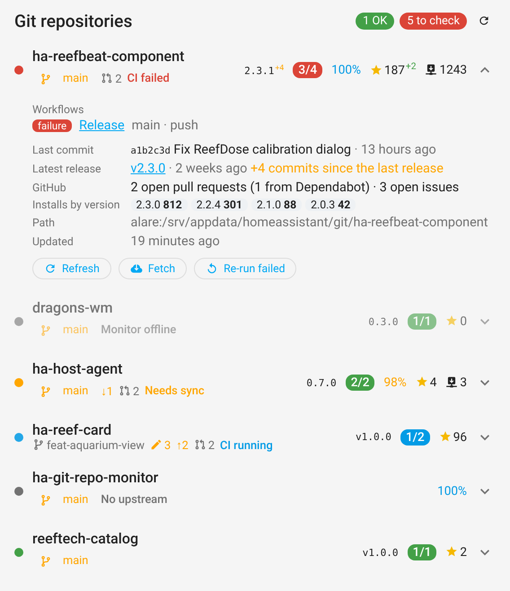

# ha-git-repo-monitor

[🇬🇧 English](../../README.md) | [🇫🇷 Français](../fr/README.md) | 🇩🇪 Deutsch | [🇪🇸 Español](../es/README.md) | [🇮🇹 Italiano](../it/README.md) | [🇵🇱 Polski](../pl/README.md) | [🇵🇹 Português](../pt/README.md)

Ein Überblick über alle Ihre Git-Repositories in Home Assistant: lokaler Zustand, GitHub Actions, Releases, Sterne und aktive Installationen. Er wird **nur aktualisiert, wenn sich etwas ändert**: ein Commit, ein Push oder das Ende eines Workflows.



Das Projekt besteht aus zwei Teilen in einem Repository:

- **ein Dienst** (Python), der auf dem Rechner mit Ihren Arbeitskopien läuft. Er veröffentlicht alles per MQTT mit der automatischen Erkennung von Home Assistant;
- **eine Lovelace-Karte** (`custom:git-repo-monitor-card`), installiert über HACS.

## Funktionsweise

| Auslöser | Was aktualisiert wird |
|---|---|
| Änderung in `.git` (inotify): Commit, Checkout, Merge, Fetch… | lokaler Zustand des Repositorys, etwa 2 s später |
| Alle `status_interval` (90 s) | nicht committete Änderungen, Abdeckungsbericht |
| GitHub-Webhook (optional) | GitHub-Zustand des Repositorys, dann „heißer" Modus |
| Ihr GitHub-Aktivitätsfeed, alle 60 s (kostenlose bedingte Anfragen) | Repositories, in die Sie gepusht oder ein Release veröffentlicht haben |
| „Heißer" Modus, alle 20 s | nach einem Push: Fetch + Workflows, bis alle Läufe beendet sind |
| Alle 20 min | vollständige Aktualisierung (Sicherheitsnetz) |
| Einmal täglich | aktive Installationen (analytics.home-assistant.io), tägliche Sterne-Referenz |

Lokale Daten: Branch, Upstream, Commits zum Pushen/Pullen, nicht committete Änderungen, letzter Tag, letzter Commit, Version aus `manifest.json` oder `package.json`, Abdeckung aus `reports/coverage.xml` (Cobertura-Format: der Dienst führt die Tests nie aus).

GitHub-Daten: letzter Lauf jedes Workflows, letztes Release und Commits seitdem, offene Pull Requests (die von Dependabot getrennt gezählt), Issues, Sterne und Forks.

Aktive Installationen: aus der öffentlichen Statistikdatei von Home Assistant, für Repositories mit einer Integration (`custom_components/<domain>/manifest.json`). Gezählt werden nur Nutzer, die die Nutzungsstatistiken aktiviert haben; Karten und Blueprints haben keine Zahl.

## Installation

### 1. Der Dienst

Kopieren Sie [`config.example.yaml`](../../config.example.yaml) nach `config.yaml` und passen Sie sie an (MQTT-Broker, Verzeichnisse der Repositories).

**Docker** (empfohlen) — siehe [`deploy/docker-compose.yml`](../../deploy/docker-compose.yml):

```bash
cd deploy
cp ../config.example.yaml config.yaml   # dann bearbeiten
GITHUB_TOKEN=github_pat_xxx GRM_MQTT_PASSWORD=xxx docker compose up -d
```

Binden Sie die Repositories unter demselben Pfad wie auf dem Host ein. Starten Sie den Container mit der UID, der die Repositories gehören (`user:`), sonst hinterlässt `git fetch` Dateien, die Ihr Konto nicht ändern kann.

**Ohne Docker** (Python ≥ 3.12): `pipx install git+https://github.com/Elwinmage/ha-git-repo-monitor`, dann die systemd-Benutzereinheit [`deploy/git-repo-monitor.service`](../../deploy/git-repo-monitor.service).

### 2. Die Karte

HACS → drei Punkte → *Benutzerdefinierte Repositories* → `https://github.com/Elwinmage/ha-git-repo-monitor`, Typ **Dashboard**. Fügen Sie dann die Karte *Git Repo Monitor* hinzu: Sie findet die Repositories selbst.

## GitHub-Token

Erstellen Sie ein *fine-grained*-Token für Ihre Repositories mit den Berechtigungen **Metadata** (lesen), **Contents** (lesen), **Actions** (lesen und schreiben: Schreiben wird nur für *Fehlgeschlagene neu starten* gebraucht) und **Pull requests** (lesen). Übergeben Sie es über `GITHUB_TOKEN`.

Dasselbe Token wird für `git fetch` verwendet: SSH-Remotes (`git@github.com:…`) werden für diesen Befehl auf HTTPS umgeschrieben, daher ist im Container kein SSH-Schlüssel nötig. Ohne Token wird nur der lokale Zustand veröffentlicht.

## Echtzeit-Webhooks (optional)

Ohne Webhooks wird ein Push von einem anderen Rechner oder das Ende eines geplanten Laufs spätestens nach 20 Minuten erkannt. Mit ihnen in wenigen Sekunden.

1. Aktivieren Sie `webhook` in `config.yaml` mit einem Secret (oder `GRM_WEBHOOK_SECRET`).
2. Machen Sie den Port des Dienstes über Ihren Reverse Proxy per HTTPS erreichbar. Auf einem Synology: *Systemsteuerung → Anmeldeportal → Erweitert → Reverse Proxy*, Quelle `https://ihre.domain:443` mit eigenem Hostnamen oder Port, Ziel `http://<rechner>:8099`. Nur `POST /webhook` und `GET /health` antworten, und jede Anfrage wird anhand ihrer HMAC-Signatur geprüft.
3. Legen Sie die Webhooks an (GitHub CLI mit dem Scope `admin:repo_hook`):

```bash
GRM_WEBHOOK_SECRET=xxx scripts/setup_webhooks.sh https://ihre.domain/webhook            # alle Ihre Repositories
GRM_WEBHOOK_SECRET=xxx scripts/setup_webhooks.sh https://ihre.domain/webhook owner/repo # einige davon
```

Das Skript kann erneut ausgeführt werden: Es aktualisiert vorhandene Webhooks. Führen Sie es erneut aus, wenn Sie ein Repository anlegen.

## Home-Assistant-Entitäten

Ein Gerät pro Repository (`<host>` ist `host_id`, `<repo>` der Verzeichnisname):

| Entität | Inhalt |
|---|---|
| `sensor.git_<repo>_status` | `ok`, `ci_failed`, `ci_running`, `needs_sync`, `no_upstream`, `unknown`; alle Details als Attribute |
| `binary_sensor.git_<repo>_ci_problem` | ein Workflow ist fehlgeschlagen (für Ihre Benachrichtigungen) |
| `binary_sensor.git_<repo>_needs_sync` | nicht committete Änderungen oder Commits zum Pushen/Pullen |
| `sensor.git_<repo>_version` | Version in der Arbeitskopie |
| `sensor.git_<repo>_stars` | Sterne (Langzeitstatistik) |
| `sensor.git_<repo>_active_installs` | aktive Installationen (nur Integrationen) |
| `sensor.git_<repo>_coverage` | Abdeckung in % (falls ein Bericht existiert) |
| `button.git_<repo>_refresh` / `_fetch` / `_rerun_failed` | Befehle |

Dazu ein Gerät für den Dienst: Anzahl der Repositories, verbleibendes GitHub-API-Kontingent, Schaltfläche *Refresh all*. Alle Entitäten werden nicht verfügbar, wenn der Dienst stoppt (MQTT Last Will).

## Kartenoptionen

```yaml
type: custom:git-repo-monitor-card
title: Meine Repositories  # optional
host: alare                # nur dieser Rechner (Standard: alle)
sort: status               # status (Probleme zuerst) | name
show_ok: true              # aktuelle Repositories anzeigen
expand_problems: false     # Repositories mit CI-Fehler aufklappen
compact: false             # eine Zeile pro Repository
show_version: true
show_ci: true
show_coverage: true
show_stars: true
show_installs: true
```

Alles lässt sich im visuellen Editor einstellen. Ein Klick auf eine Zeile zeigt die fehlgeschlagenen Workflows, den letzten Commit, das letzte Release, die Installationen pro Version und die Schaltflächen *Aktualisieren*, *Fetch* und *Fehlgeschlagene neu starten*.

## MQTT-Topics

| Topic | Inhalt |
|---|---|
| `git_repo_monitor/<host>/availability` | `online` / `offline` (retained, Last Will) |
| `git_repo_monitor/<host>/<repo>/state` | JSON-Zustand des Repositorys (retained) |
| `git_repo_monitor/<host>/<repo>/cmd` | `refresh`, `fetch`, `rerun_failed` |
| `git_repo_monitor/<host>/bridge` | Zusammenfassung des Dienstes |
| `git_repo_monitor/<host>/cmd` | `refresh_all` |

## Entwicklung

```bash
pip install -e ".[test]" && pytest     # 100 % Abdeckung erforderlich, Bericht in reports/
cd card && npm install && npm run build
```

Releases entstehen mit dem Workflow *Release* (Versionsnummer als Eingabe): Er aktualisiert die Versionen, baut die Karte, die dem GitHub-Release beigefügt wird, und veröffentlicht das Image `ghcr.io/elwinmage/ha-git-repo-monitor`.
