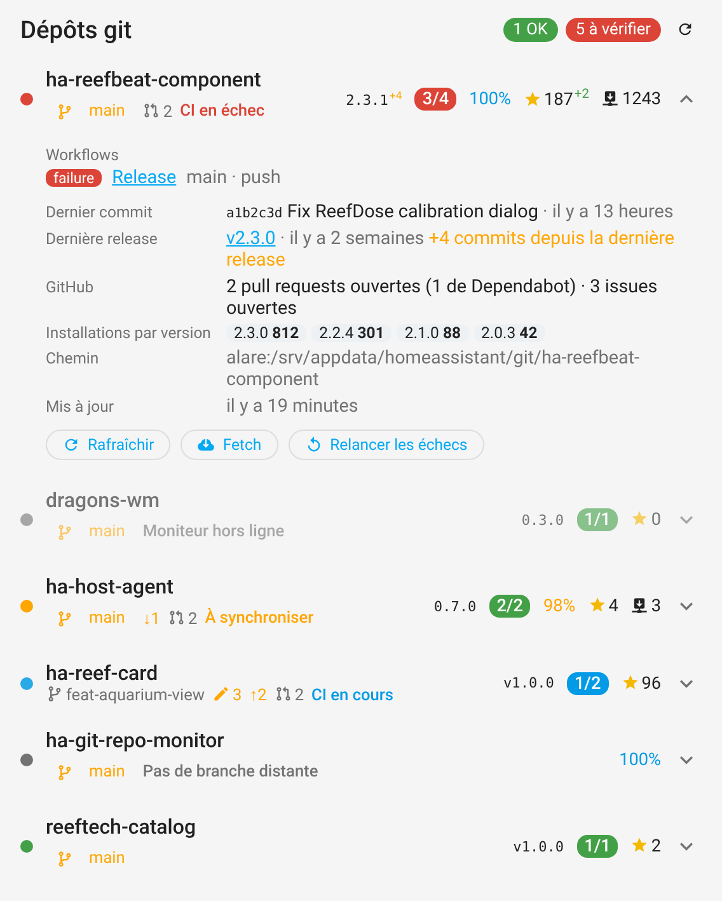

# ha-git-repo-monitor

[🇬🇧 English](../../README.md) | 🇫🇷 Français | [🇩🇪 Deutsch](../de/README.md) | [🇪🇸 Español](../es/README.md) | [🇮🇹 Italiano](../it/README.md) | [🇵🇱 Polski](../pl/README.md) | [🇵🇹 Português](../pt/README.md)

Une vue d'ensemble de tous vos dépôts git dans Home Assistant : état local, GitHub Actions, releases, étoiles et installations actives. Elle est rafraîchie **seulement quand quelque chose change** : un commit, un push ou la fin d'un workflow.



Le projet a deux parties dans un même dépôt :

- **un démon** (Python) qui tourne sur la machine où sont vos copies de travail. Il publie tout en MQTT, avec la découverte automatique de Home Assistant ;
- **une carte Lovelace** (`custom:git-repo-monitor-card`), installée par HACS.

## Fonctionnement

| Déclencheur | Ce qui est rafraîchi |
|---|---|
| Changement dans `.git` (inotify) : commit, checkout, merge, fetch… | état local du dépôt, environ 2 s après |
| Toutes les `status_interval` (90 s) | modifications non commitées, rapport de couverture |
| Webhook GitHub (optionnel) | état GitHub du dépôt, puis mode « chaud » |
| Votre flux d'activité GitHub, toutes les 60 s (requêtes conditionnelles gratuites) | dépôts sur lesquels vous avez poussé ou publié |
| Mode « chaud », toutes les 20 s | après un push : fetch + workflows, jusqu'à la fin de tous les runs |
| Toutes les 20 min | rafraîchissement complet (filet de sécurité) |
| Une fois par jour | installations actives (analytics.home-assistant.io), référence quotidienne des étoiles |

Données locales : branche, branche distante, commits à pousser ou à récupérer, modifications non commitées, dernier tag, dernier commit, version du `manifest.json` ou du `package.json`, couverture lue dans `reports/coverage.xml` (format Cobertura : le démon ne lance jamais les tests).

Données GitHub : dernier run de chaque workflow, dernière release et commits depuis, pull requests ouvertes (celles de Dependabot comptées à part), issues, étoiles et forks.

Installations actives : prises dans le fichier public des statistiques de Home Assistant, pour les dépôts qui contiennent une intégration (`custom_components/<domaine>/manifest.json`). Seuls les utilisateurs qui ont activé les statistiques d'usage sont comptés ; les cartes et les blueprints n'ont pas de chiffre.

## Installation

Ce tutoriel part d'une machine vierge et s'arrête sur une carte qui fonctionne. Comptez une vingtaine de minutes.

Avant de commencer, il vous faut : la machine où sont vos copies de travail, avec **Docker** ou **Python ≥ 3.12** ; un **broker MQTT** déjà relié à Home Assistant (le module Mosquitto fait très bien l'affaire) et l'intégration **MQTT** configurée ; **HACS** installé. Le jeton GitHub est optionnel : sans lui, la carte affiche quand même l'état local.

### Étape 1 — Récupérer un accès MQTT

Le démon se connecte au broker comme n'importe quel autre client. Avec le module Mosquitto, le plus simple est un utilisateur Home Assistant dédié : *Paramètres → Personnes → Ajouter une personne*, activez *Autoriser la personne à se connecter*, nommez-le `git_monitor`. Notez l'adresse du broker (la machine Home Assistant, port 1883 par défaut) et ce couple identifiant/mot de passe.

### Étape 2 — Créer le jeton GitHub (recommandé)

Sur GitHub : *Settings → Developer settings → Personal access tokens → Fine-grained tokens → Generate new token*.

- *Repository access* : **All repositories**, ou seulement ceux que vous surveillez ;
- *Permissions* : **Metadata** (lecture), **Contents** (lecture), **Actions** (lecture **et écriture** — l'écriture ne sert qu'à *Relancer les échecs*), **Pull requests** (lecture).

Copiez tout de suite la valeur `github_pat_…`, GitHub ne la réaffichera jamais. Ce même jeton sert à `git fetch` : les remotes SSH (`git@github.com:…`) sont réécrits en HTTPS pour cette commande, il n'y a donc pas besoin de clé SSH dans le conteneur. Sans jeton, le démon écrit `No GitHub token: only the local state is monitored` dans ses logs et ne publie que l'état local.

### Étape 3 — Écrire la configuration

Sur la machine où sont les dépôts :

```bash
git clone https://github.com/Elwinmage/ha-git-repo-monitor
cd ha-git-repo-monitor/deploy
cp ../config.example.yaml config.yaml
```

Trois clés à adapter dans `config.yaml`, le reste peut rester tel quel :

```yaml
host_id: alare                       # nom de cette machine dans HA (défaut : le nom d'hôte)
mqtt:
  host: 192.168.0.109                # votre broker (étape 1)
  username: git_monitor              # le mot de passe vient de l'environnement, étape 4
repos:
  base_dirs:
    - /srv/appdata/homeassistant/git  # répertoire qui contient vos copies de travail
```

Toute copie de travail git directement sous `base_dirs` est surveillée (`depth: 1` ; augmentez-le si vos dépôts sont rangés dans des sous-répertoires). Les secrets restent hors du fichier : ils sont lus dans l'environnement, et [`config.example.yaml`](../../config.example.yaml) documente toutes les autres clés.

### Étape 4 — Lancer le démon

**Avec Docker** (recommandé). Toujours dans `deploy/`, mettez les secrets dans un fichier `.env` à côté du `docker-compose.yml`, et relevez l'uid/gid propriétaire des dépôts :

```bash
cat > .env <<'EOF'
GITHUB_TOKEN=github_pat_xxx
GRM_MQTT_PASSWORD=xxx
EOF
chmod 600 .env
id -u ; id -g
```

Éditez ensuite [`deploy/docker-compose.yml`](../../deploy/docker-compose.yml) : ces uid/gid dans `user:`, et vos `base_dirs` montés **au même chemin dedans et dehors** (la carte affiche alors le vrai chemin de l'hôte). Lancer le conteneur avec un autre uid est l'erreur classique : `git fetch` laisserait des fichiers que votre propre compte ne peut plus modifier.

```bash
docker compose up -d
docker compose logs -f
```

**Sans Docker** (Python ≥ 3.12), avec l'unité systemd utilisateur [`deploy/git-repo-monitor.service`](../../deploy/git-repo-monitor.service) :

```bash
pipx install git+https://github.com/Elwinmage/ha-git-repo-monitor
mkdir -p ~/.config/git-repo-monitor ~/.config/systemd/user
cp config.yaml ~/.config/git-repo-monitor/config.yaml
printf 'GITHUB_TOKEN=github_pat_xxx\nGRM_MQTT_PASSWORD=xxx\n' > ~/.config/git-repo-monitor/env
chmod 600 ~/.config/git-repo-monitor/env
cp git-repo-monitor.service ~/.config/systemd/user/
systemctl --user daemon-reload && systemctl --user enable --now git-repo-monitor
loginctl enable-linger "$USER"   # le garder actif sans session ouverte
journalctl --user -u git-repo-monitor -f
```

Dans les deux cas, les logs doivent afficher une ligne `Repository <nom> found at <chemin>` par dépôt, puis `Watching N git directories`. Une ligne `Configuration error: …` signifie que `config.yaml` a été refusé : le tableau en fin de section donne les causes habituelles.

### Étape 5 — Vérifier dans Home Assistant

*Paramètres → Appareils et services → MQTT → appareils* : un appareil par dépôt, plus un pour le démon lui-même. Ouvrez-en un — `sensor.git_<repo>_status` doit déjà contenir `ok`, `needs_sync`, `ci_failed`… Si rien n'apparaît alors que les logs sont propres, Home Assistant ne lit pas le broker dans lequel le démon écrit.

### Étape 6 — Installer la carte

*HACS → trois points (en haut à droite) → Dépôts personnalisés* : URL `https://github.com/Elwinmage/ha-git-repo-monitor`, type **Tableau de bord**, *Ajouter*. Ouvrez ensuite *Git Repo Monitor card* et téléchargez-la. Rechargez la page (`Ctrl-Maj-R`) pour que le navigateur prenne le nouveau fichier.

### Étape 7 — Ajouter la carte à un tableau de bord

*Modifier le tableau de bord → Ajouter une carte*, puis cherchez *Git Repo Monitor*. Elle trouve les dépôts toute seule ; tout le reste est optionnel et se règle dans l'éditeur visuel, voir [Options de la carte](#options-de-la-carte).

L'installation est terminée. L'étape suivante est optionnelle : elle fait réagir la partie GitHub de la carte en quelques secondes au lieu de quelques minutes.

### Étape 8 (optionnel) — Webhooks temps réel

Sans webhooks, un push depuis une autre machine ou la fin d'un run planifié est vu au plus tard en 20 minutes. Avec, en quelques secondes.

1. Dans `config.yaml`, mettez `webhook.enabled: true`, ajoutez le secret dans `GRM_WEBHOOK_SECRET` (dans `.env` ou dans le fichier `env`) et redémarrez le démon : le log affiche `Webhook listening on 0.0.0.0:8099/webhook`.
2. Exposez ce port par votre reverse proxy, en HTTPS. Sur un Synology : *Panneau de configuration → Portail de connexion → Avancé → Proxy inversé*, source `https://votre.domaine:443` avec un nom d'hôte ou un port dédié, destination `http://<machine>:8099`. Seuls `POST /webhook` et `GET /health` répondent, et chaque requête est vérifiée par sa signature HMAC — `curl https://votre.domaine/health` doit répondre `ok`.
3. Créez les webhooks avec GitHub CLI (`gh auth login`, avec le scope `admin:repo_hook`) :

```bash
GRM_WEBHOOK_SECRET=xxx scripts/setup_webhooks.sh https://votre.domaine/webhook            # tous vos dépôts
GRM_WEBHOOK_SECRET=xxx scripts/setup_webhooks.sh https://votre.domaine/webhook owner/repo # certains
```

Le script peut être relancé : il met à jour les webhooks existants. Relancez-le quand vous créez un dépôt. Sur GitHub, *Settings → Webhooks* d'un dépôt montre chaque livraison et sa réponse (`202 accepted`).

### En cas de problème

| Symptôme | Où regarder |
|---|---|
| `Configuration error: repos.base_dirs must list at least one directory` | mauvais fichier lu (`-c`), ou `base_dirs` laissé vide |
| `MQTT connection lost: …` en boucle | adresse du broker, identifiant, `GRM_MQTT_PASSWORD` |
| Aucun appareil dans Home Assistant alors que les logs sont propres | intégration **MQTT** absente, ou `discovery_prefix` différent de `homeassistant` |
| `Cannot list <répertoire>` | mauvais `base_dirs`, ou répertoire illisible pour l'uid du démon |
| Aucun dépôt trouvé | copies de travail plus profondes que `depth`, ou motif `exclude` trop large |
| Dépôts publiés, mais aucune donnée GitHub | pas de jeton (`No GitHub token` dans les logs) ou permissions manquantes |
| `git fetch failed for <repo>` | jeton sans **Contents** (lecture), ou dépôt privé hors de sa portée |
| `dubious ownership` dans les logs | conteneur lancé avec un autre uid que le propriétaire des dépôts |
| *Git Repo Monitor* absent de la liste des cartes | téléchargement HACS non terminé, ou page non rechargée |

## Entités Home Assistant

Un appareil par dépôt (`<host>` est `host_id`, `<repo>` le nom du répertoire) :

| Entité | Contenu |
|---|---|
| `sensor.git_<repo>_status` | `ok`, `ci_failed`, `ci_running`, `needs_sync`, `no_upstream`, `unknown` ; tout le détail en attributs |
| `binary_sensor.git_<repo>_ci_problem` | un workflow a échoué (pour vos notifications) |
| `binary_sensor.git_<repo>_needs_sync` | modifications non commitées ou commits à pousser/récupérer |
| `sensor.git_<repo>_version` | version dans la copie de travail |
| `sensor.git_<repo>_stars` | étoiles (statistiques long terme) |
| `sensor.git_<repo>_active_installs` | installations actives (intégrations seulement) |
| `sensor.git_<repo>_coverage` | couverture en % (si un rapport existe) |
| `button.git_<repo>_refresh` / `_fetch` / `_rerun_failed` | commandes |

Plus un appareil pour le démon : nombre de dépôts, quota d'API GitHub restant, bouton *Refresh all*. Toutes les entités deviennent indisponibles quand le démon s'arrête (dernière volonté MQTT).

## Options de la carte

```yaml
type: custom:git-repo-monitor-card
title: Mes dépôts          # optionnel
host: alare                # seulement cette machine (défaut : toutes)
repos:                     # seulement ces dépôts, dans cet ordre (défaut : tous)
  - alare/ha-reef-card
  - alare/ha-reefbeat-component
sort: status               # status (problèmes en premier) | name
show_ok: true              # afficher les dépôts à jour
expand_problems: false     # déplier les dépôts dont la CI a échoué
compact: false             # une ligne par dépôt
show_version: true
show_ci: true
show_coverage: true
show_stars: true
show_installs: true
```

Tout se règle dans l'éditeur visuel, la liste des dépôts comprise : ajoutez ceux que vous voulez, puis montez-les ou descendez-les jusqu'à obtenir l'ordre voulu. Liste vide : tous les dépôts, triés selon `sort` ; liste renseignée : elle l'emporte sur `sort`. Une entrée peut aussi être un simple nom de répertoire (`ha-reef-card`), pour le reconnaître sur n'importe quelle machine. Un clic sur une ligne affiche les workflows en échec, le dernier commit, la dernière release, les installations par version et les boutons *Rafraîchir*, *Fetch* et *Relancer les échecs*.

## Topics MQTT

| Topic | Contenu |
|---|---|
| `git_repo_monitor/<host>/availability` | `online` / `offline` (retenu, dernière volonté) |
| `git_repo_monitor/<host>/<repo>/state` | état JSON du dépôt (retenu) |
| `git_repo_monitor/<host>/<repo>/cmd` | `refresh`, `fetch`, `rerun_failed` |
| `git_repo_monitor/<host>/bridge` | résumé du démon |
| `git_repo_monitor/<host>/cmd` | `refresh_all` |

## Développement

```bash
pip install -e ".[test]" && pytest     # 100 % de couverture exigés, rapport dans reports/
cd card && npm install && npm run build
```

Les versions se publient avec le workflow *Release* (numéro de version en entrée) : il met à jour les versions, construit la carte jointe à la release GitHub et publie l'image `ghcr.io/elwinmage/ha-git-repo-monitor`.
